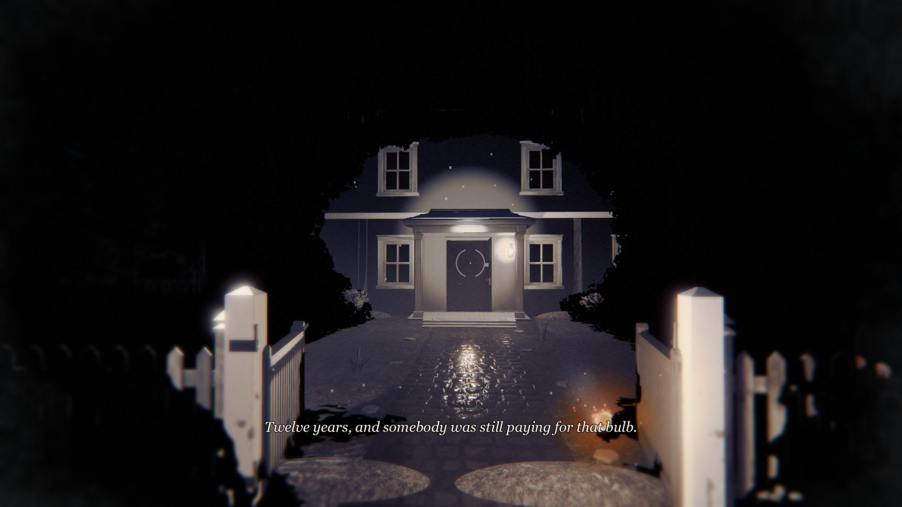
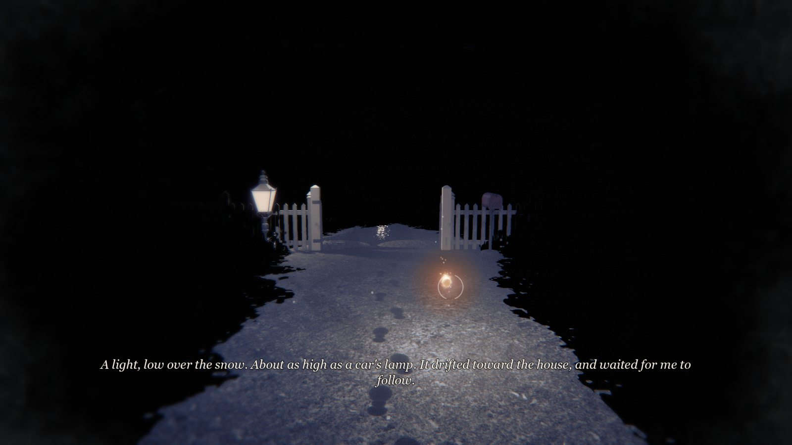
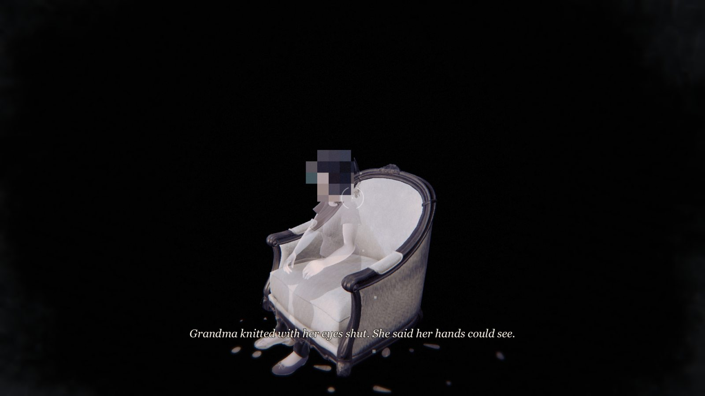
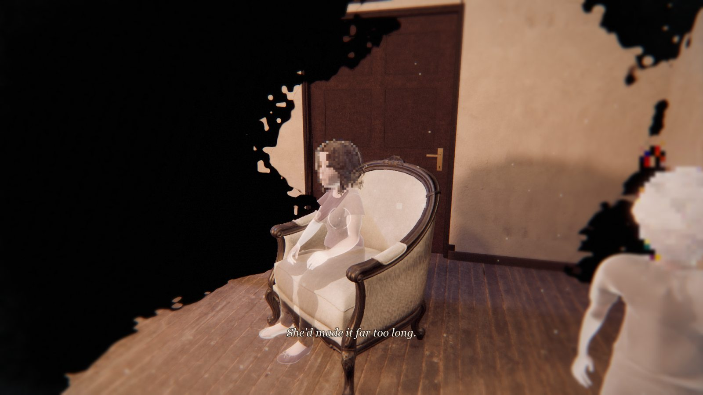
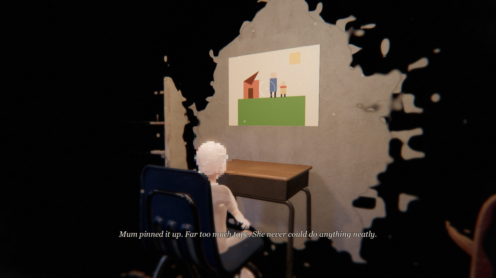
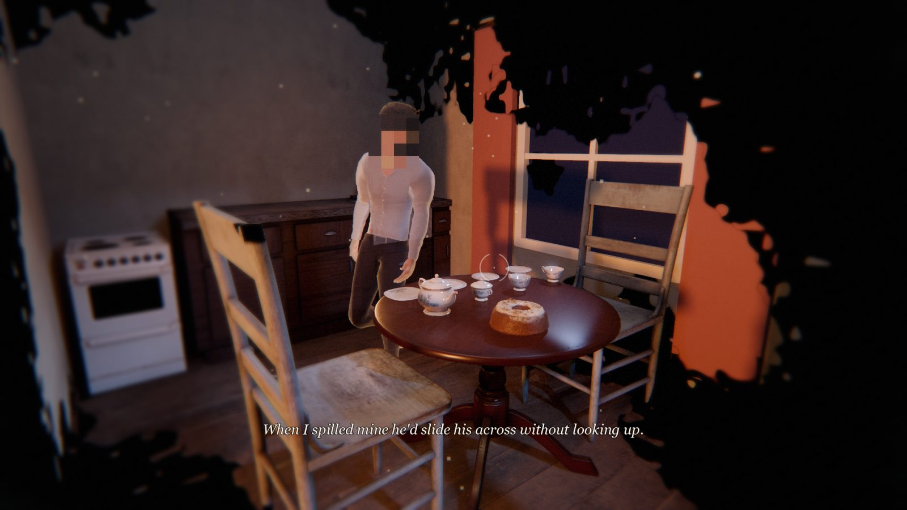
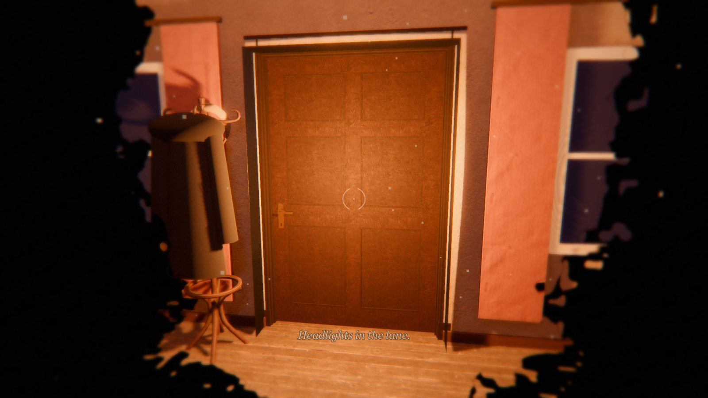

<div align="center">



# UNSENT

### Some doors you only open by closing your eyes.

**A first-person psychological thriller about going home after twelve years. Every memory is a patch of light in the dark, and you play it by blinking.**


[Overview](#overview) ·
[Showcase](#showcase) ·
[How blinking works](#how-blinking-works) ·
[Features](#features) ·
[The look](#the-look) ·
[Controls](#controls) ·
[Getting started](#getting-started) ·
[Testing](#testing) ·
[Architecture](#architecture) ·
[Credits](#credits)

</div>

---

## Overview

You step off the last bus in the snow and walk up a lane you swore you would never walk again. The porch light is on. It has been on for twelve years, and somebody has been paying for that bulb.

You are not walking through a house. You are *remembering* one. Each memory is a small island of warm light floating in total darkness: a grandmother knitting with her eyes shut, a drawing taped to a wall, two cups on a kitchen table, one of them still full. Everything outside the island is black. You cannot walk, you cannot reach. You can only **look**, and **blink**.

Blink at the right moment and a memory opens up. Blink at the wrong one and it is gone, cut off mid-sentence, and you are somewhere else, years away.

The story is a short thriller about a son, a house and a half-heard sentence. It runs about **22 scenes** and ends in one sitting. Faces are pixelated because you forgot them. Some things you only hear with your eyes shut. And the thing you remember is not quite what happened.

<p align="center">
  
  <br><sub><i>The first scene. One set of footprints, and a light low over the snow, "about as high as a car's lamp".</i></sub>
</p>

## Showcase

All images are real in-engine captures from the game, taken by its own autoplay mode (`--blinkshots`).

### A memory is a patch of light in the dark

<table>
  <tr>
    <td width="50%"></td>
    <td width="50%"></td>
  </tr>
  <tr>
    <td align="center"><sub><b>Before.</b> Grandma, her chair, and nothing else. The rest is not there yet.</sub></td>
    <td align="center"><sub><b>After one blink at the eye.</b> The room blooms in like ink on wet paper, and the boy who was watching appears.</sub></td>
  </tr>
</table>

### Every scene is a different year

<table>
  <tr>
    <td width="50%"></td>
    <td width="50%"></td>
  </tr>
  <tr>
    <td align="center"><sub><b>Seven.</b> The drawing of the house, always with the porch light on.</sub></td>
    <td align="center"><sub><b>Nine.</b> Three plates. Dad nearest the stove, so he could reach the kettle.</sub></td>
  </tr>
</table>

<p align="center">
  
  <br><sub><i>The last scene. Headlights in the lane. Footsteps on the porch. Do not blink.</i></sub>
</p>

## How blinking works

One button. That is the whole interface.

| Situation | What a blink does |
| :-- | :-- |
| **Early in a memory** | Nothing. It is safe. The lids close and open. |
| **While looking at the white eye** | You look closer. Ghosts wake, the room blooms, colour and warmth return. |
| **After the metronome starts ticking** | You let go. The memory is cut and you open your eyes in another year. |
| **Held shut** | You hear what the memory was hiding: a murmur behind a door, steps on the stairs, a car. |

A few rules make it feel fair:

- **The metronome only appears after every line has been said.** You are never cut off by accident while someone is talking.
- **If you blink over a line anyway,** the words you heard stay on screen with a dash, dim, then fade. You know something was left unsaid.
- **Every swap happens while your eyes are fully shut.** You never see the cut.
- **Something in each scene changes when you blink at the eye.** If it does not, it is a bug.

## Features

**Memories as islands**
- A full-screen shader rebuilds each pixel's position from the depth buffer and paints everything outside the active islands black, with a ragged, boiling ink edge. The islands are locked to the room, so the black cuts across furniture with real parallax.
- Islands bloom open like ink on wet paper, and wither one step at a time in the montage scenes.

**Show, do not tell**
- A figure in the window is gone after your first blink.
- A figure steps closer every time you blink, until a single headlight is all that is left.
- Faces are pixelated, and never fully clear.

**22 scenes, one story**
- Road, gate, porch. A living room, a bedroom, a kitchen, a study door. A lane at night. A fireplace. A door.
- Each scene has a time card ("Nine.", "That night.", "Now.") and a camera that can only sway a few centimetres, like a diorama.
- Fair-play clues are planted early, so the ending can be worked out by an attentive player.

**Everything is voiced**
- Narrator, Mum and Dad are voiced, with remembered voices running through a separate low-passed bus.
- Lines are sped up slightly at the same pitch so the pace feels natural, not dragged.
- A caption that mixes speech and narration is split onto separate lines, timed to the voice.

**Soft focus where you look**
- A gentle radial focus follows the reticle, so the area you are looking at is only slightly clearer.

**Procedural craft, no placeholder boxes**
- Six-panel wooden doors with handles, hinges and moulded frames, generated in code.
- Footprints in snow, half filled in, generated textures and decals.
- Solid, faded ghosts built from two shader passes, so you never see a body through clothes.

## The look

- **Memory void.** Black outside the islands, ink at the edges.
- **Worn camera.** Slight lens bend, colour fringe, grain that grows in the dark, film vignette.
- **Cold against warm.** The world starts desaturated and returns to colour as you remember. It drains again as memories slip away.
- **Ghosts.** Faded, ember-gold, glowing at the rim, with faces that stay a mosaic.
- **Sound.** Solo piano on the title, a broken music-box theme, and the full theme only at the very end.

## Controls

| Action | Input | Notes |
| :-- | :-- | :-- |
| Blink | `Space`, `LMB` or gamepad `A` | Tap to blink, hold to keep your eyes shut |
| Look | Mouse or right stick | The view leans toward the reticle |
| Look closer | Reticle on the white eye, then blink | Only works while the eye is showing |

The original walking version of the game (move, look, interact) uses the inputs defined in `project.godot`.

## Getting started

### Requirements

- **Godot 4.7** (built and tested with 4.7.2), standard build, Forward+ renderer.
- **OS:** Windows 10/11 64-bit (primary target).
- **GPU:** Vulkan-capable recommended.
- **Input:** mouse and keyboard, or a gamepad.

### Run it

```powershell
git clone https://github.com/jaatboy09030-create/ember-of-memories-.git
cd ember-of-memories-

# play the blink experience
godot --path . res://scenes/prototypes/blink_demo.tscn

# jump straight to a scene (skips the intro)
godot --path . res://scenes/prototypes/blink_demo.tscn -- --blinkstart=WintersBeat

# open in the editor
godot --path . --editor
```

Use your own Godot path if `godot` is not on your PATH, for example `& "C:\Program Files\Godot\Godot.exe"`.

The project also contains the original walking game (`res://scenes/main.tscn`): walk the house, restore seven memories with small mini-games, and relight the fire.

> **Optional asset.** The ember flame in the walking game uses *Vefects Stylized Fire* from the Godot Asset Store. Its licence forbids public repositories, so it is git-ignored. Install it into `res://Vefects/` to see the original flame.

## Testing

Everything runs headless and prints `TEST ... PASS` or `FAIL`.

```powershell
godot --headless --path . -- --storytest                                   # the walking story
godot --headless --path . -- --walktest                                    # walking
godot --headless --path . res://scenes/main.tscn -- --doortest             # doors
godot --headless --path . res://scenes/prototypes/blink_demo.tscn -- --blinkcheck   # every figure and prop sits on a surface
```

Screenshot and debug flags for the blink experience (put them after `--`):

| Flag | What it does |
| :-- | :-- |
| `--blinkshots=<folder>` | Plays the whole experience automatically and saves screenshots |
| `--blinkonly=<BeatName>` | With `--blinkshots`, only that scene |
| `--blinkstart=<BeatName>` | Start playing at that scene |
| `--blinknovoid` | Debug: show the whole room without the black void |

## Architecture

```
project.godot            engine config, input map, autoload, shader globals
scenes/
  main.tscn              the house and every system of the walking game
  prototypes/            blink_demo.tscn: the 22-scene blink experience
scripts/
  prototypes/blink/      the blink toolkit (below)
  objects/               doors, footprints, ghost figures
  systems/               sound, screen effects
shaders/                 blink void, eyelids, ghost, camera, snow, fire
tools/                   one-off headless scripts (level builder, voice-over generator)
research/                design notes and reference studies
MEMORY/                  the knowledge base: architecture, recipes, gotchas
```

**The blink toolkit** (`scripts/prototypes/blink/`)

| Piece | Does |
| :-- | :-- |
| `MemoryBeat` | One remembered moment: a camera spot, lines and timings, islands, an eye hotspot, what is heard with eyes closed |
| `MemoryIsland` | A patch of the room that shows through the dark, and blooms or withers |
| `EyeHotspot` | The white eye: what a blink at it wakes, shows and says |
| `MemoryVoid` | The full-screen shader quad that paints the dark |
| `Eyelids` | Curved lids that close, hold and open, and flutter when you are tired |
| `MemoryCamera` | A few degrees of sway and a few centimetres of slide, like a diorama |
| `BlinkCaption` | Voiced captions, split lines, and the cut-off words with a dash |
| `BeatCue` | A timed sound or action when a scene opens: a door swinging, headlights, steps |

**Adding a scene** means adding a `MemoryBeat` under `Beats/` in the scene, giving it a camera point, islands and lines, and re-running the voice-over tool. Start at [`MEMORY/11-blink-demo.md`](MEMORY/11-blink-demo.md).

**Where to start reading.** [`MEMORY/README.md`](MEMORY/README.md) is the index. Good first stops are `01-project-overview.md`, `02-architecture.md`, `10-story-and-gameplay.md` and `11-blink-demo.md`.

## Credits

- **Models and textures:** [Poly Haven](https://polyhaven.com) (CC0) and [Quaternius](https://quaternius.com) (CC0).
- **Sketchfab models** (CC-BY 4.0): credited in [`assets/sketchfab/CREDITS.md`](assets/sketchfab/CREDITS.md).
- **Characters and animation:** Mixamo.
- **The house:** Tripo AI parts assembled and modelled in Blender.
- **Font:** Bodoni Moda (SIL Open Font License).
- **Voices:** generated with ElevenLabs. After changing a caption, re-run `tools/blink_voice_over.py` or it plays silent.
- **Built with** [Godot](https://godotengine.org) and [Claude Code](https://claude.com/claude-code).

**Team:** XMavrik (original build), Agrim Singh (restructure), Suyash (owner).

> No licence file is included yet. Until one is added, all rights are reserved by the authors.
